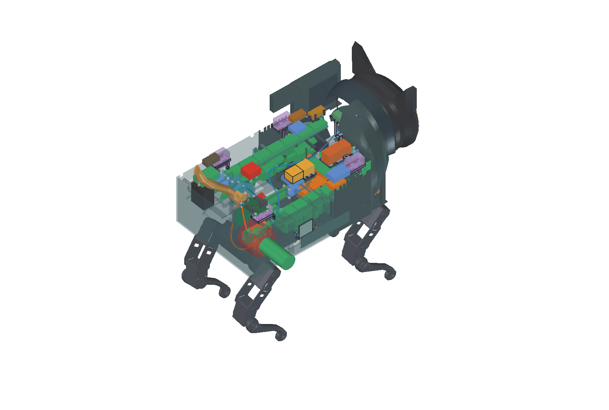

# 20G — S0, przewody i montaż w otwartej ramie

**Model referencyjny. Mocowanie S0 ma status HOLD.** Geometria przewodów i wsunięcie sztywnego zespołu zostały sprawdzone cyfrowo. Nie ma nowego druku ani eksportu podstawy. Zachowano geometrię dziesięciu części odebranych w 20C/20D.

## Połączenia i zapas przewodów

| Fizyczny odcinek | Połączenie | Warunkowy odcinek nominalny |
| --- | --- | --- |
| W076/custom | POST_F0.2 → S0.IN | **389 mm**, w tym końce i zapas ułożenia z 20F |
| W066 | S0.OUT → P_SYS.1 | **260 mm** = 210,315 mm ułożenia + 29 mm na oba końce + 20 mm na ułożenie, zaokrąglone w górę |
| W076/factory | F0.out → POST_F0.1 | Całe fabryczne wyjście FHAC0002, bez cięcia |
| W077 | F_PI.out → SPLICE_PI.16 | Niezależny fabryczny odcinek zachowany |

W066 i W076/custom używają HELU 23802 Ø4,2 mm. W066 ma wewnętrzny promień gięcia 25,2 mm i obwiednię z odstępem 1,25 mm względem sprawdzonych części. Pełne oczka IN i OUT przyjęły odpowiednio −30° i −105,522° wokół osi +Y, każde na swoim istniejącym trzpieniu. Bazowy plan całego projektu przewiduje 3 m LAPP 0107001 i 9 m HELU 23802. Rzeczywista dostępność, cięcie, luz i dopasowanie są nieznane. Długości w tabeli służą do planowania, więc przed cięciem sprawdź oba odcinki z fizycznymi końcówkami.

## Kolejność pierwszej przymiarki bez zasilania

1. Na stole załóż kompletne stosy oczek i elementów M10, z przewodami pozostawionymi luźno. Sprawdź rzeczywiste oparcie i izolację obu zacisków oraz wejście nasadki. Próba cyfrowa użyła nasadki o obwiedni Ø24 mm i 7,75 mm nominalnego zazębienia.
2. Przy zdjętych pokrywach, wyjętym kluczu i przed montażem E1 opuść sztywny zespół S0 z przewodami tymczasowo podtrzymywanymi od góry. Model przeszedł opuszczenie o 64 mm przy odsunięciu o 6 mm w −Y, a następnie dosunięcie o 6 mm w +Y. Przebieg luźnych przewodów w rękach sprawdź na sucho.
3. Przed osadzeniem E1 sprawdź komplet mocowania i klucz. Przewidziano **2× DIN 912 M6×20, 4× podkładka 6,4×12×1,6 mm, 2× nakrętka M6 AF10 o wysokości 5 mm**. Dostępność elementów pozostaje niepotwierdzona. Sprawdź z tyłu rzeczywiste gniazda, oparcie podkładek, końcówki śrub, zazębienie nakrętek i dojście do przeciwtrzymania.
4. Po potwierdzeniu mocowania wprowadź kompletny lutowany E1, potem banki. Ułóż przewody na stałe, podłącz wolne końce odpowiednio do POST_F0.2 i P_SYS.1 i zamknij osłony. Przy sporadycznej naprawie E1 można wyjąć.

## Warunek zamknięcia mocowania

Baza 20D ma przejście Ø22,8 mm i materiał przecinający oba planowane otwory M6. Rysunek HELLA wskazuje przejście Ø24 mm, dwa otwory Ø6,5 mm i rozstaw 38 mm. Układ pionowy względem pary zacisków pochodzi z wcześniejszego projektu mocowania i wymaga potwierdzenia na części.

Po odtworzeniu samych otworów zewnętrzne podkładki nadal przecinają nierówną powierzchnię podstawy. Łby i podkładki wchodzą też w modelową obwiednię obrotu klucza R15. Dla założonego położenia S0 i 1,25 mm odstępu, rzeczywisty obracający się zespół musi zmieścić się w promieniu określonym poniżej. [Próba CAD](20G-assembly-gate.json)

| Pasmo w modelu | Maksymalny promień klucza od osi S0 |
| --- | --- |
| Y102–103,6 mm przy zewnętrznych podkładkach | 11,75 mm |
| Y103,6–109,6 mm przy łbach | 12,75 mm |

Zmierz ruch klucza i kształt tylnego osadzenia na rzeczywistym S0. Sam model korpusu jest pełną bryłą zastępczą i zakrywa niezwymiarowane miejsca oparcia i wejścia narzędzi. Wynik fizycznej próby pozostaje otwarty. [Plik FreeCAD](whole-cat20G.FCStd) · [Źródła i sumy SHA-256](20G-manifest.json)
